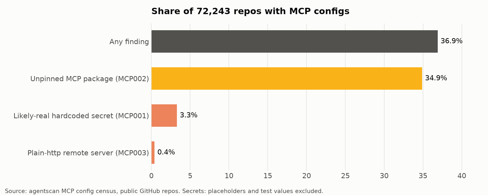
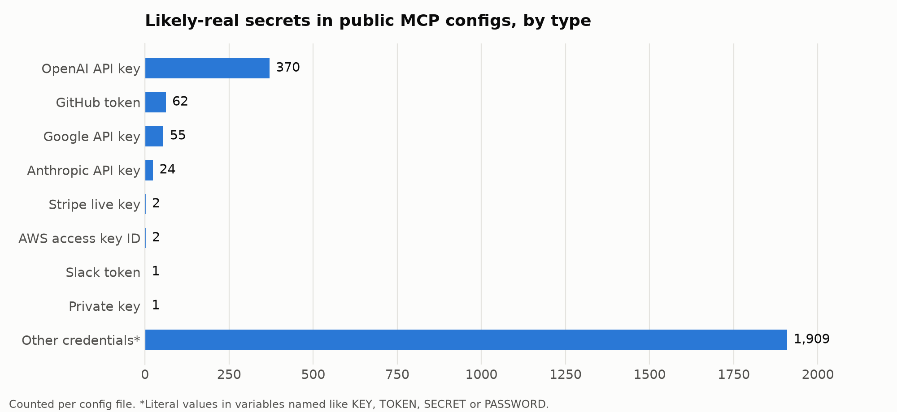
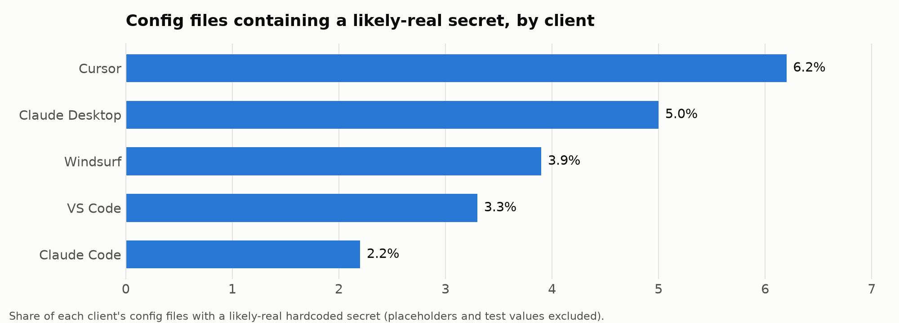
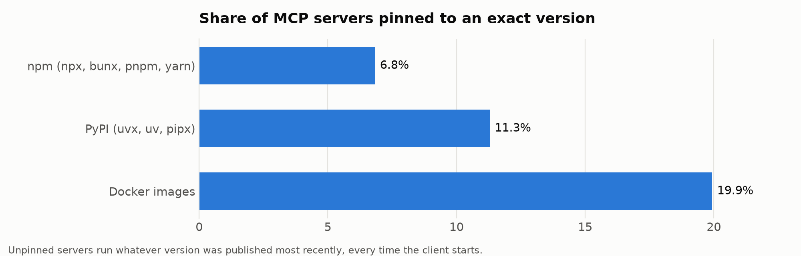
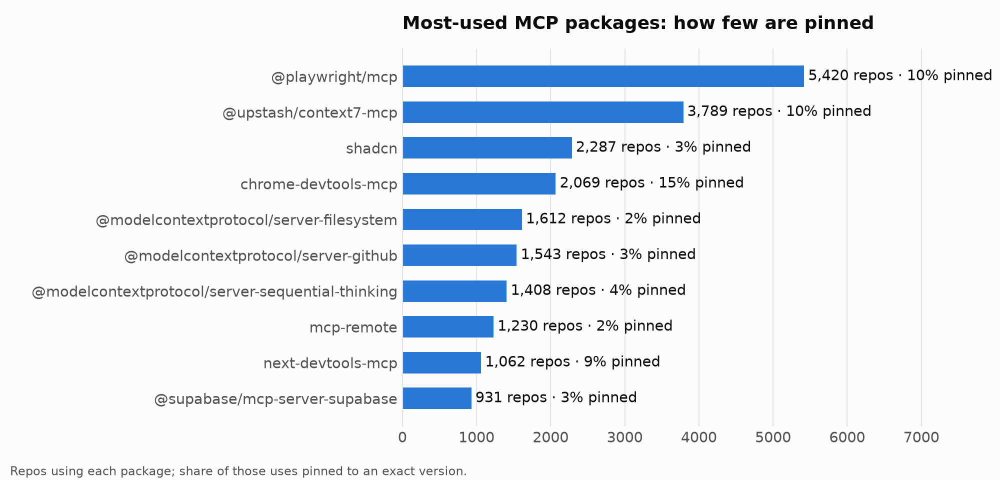

# I scanned 72,000 public AI agent configs. Here's what's exposed, and how to fix yours.

*Mayur Sonawane · October 2026 · [agentscan](https://github.com/SonawaneMayur/agentscan)*

AI coding assistants such as Claude Code, Cursor, VS Code and Windsurf connect to external tools
through **MCP servers**. Each server is declared in a small JSON config file, and that file decides
three things: **what code runs on your machine, which credentials it receives, and where your data
goes.** Developers commit these files to GitHub all the time, usually without anyone reviewing them.

So I measured what's in them. I collected every MCP config file GitHub's code search could reach,
then scanned each one with [agentscan](https://github.com/SonawaneMayur/agentscan), the open-source
scanner I built for this.

## TL;DR

Across **84,813 MCP config files in 72,243 public repositories**:

- **36.9% of repos have at least one security finding.**
- **2,356 repos (3.3%) publish what looks like a real credential**, including 370 OpenAI keys,
  62 GitHub tokens, 55 Google API keys, 24 Anthropic keys and 2 Stripe live keys.
- **Only 6.8% of npm-based MCP servers are pinned to a version.** The other 93% download and run
  whatever was published most recently, every time the editor starts.
- **The most popular MCP servers are the least pinned:** `@playwright/mcp`, used in 5,420 repos,
  is pinned in 10% of them.



## Why an MCP config matters

A typical entry looks like this:

```json
{
  "mcpServers": {
    "github": {
      "command": "npx",
      "args": ["-y", "@modelcontextprotocol/server-github"],
      "env": { "GITHUB_PERSONAL_ACCESS_TOKEN": "ghp_..." }
    }
  }
}
```

Four lines, three decisions:

1. **`npx -y <package>`** downloads a package from npm and runs it with your user's permissions,
   with no version, so it's whatever is newest *right now*.
2. **`env`** hands that process a credential. Here, a GitHub token that can read and write your
   repositories.
3. **The server's tool descriptions go straight into your AI assistant's context**, so a
   compromised server can also steer what the assistant does.

That's a supply chain, a credential store and a prompt-injection surface in one file. Most teams
review their `package.json` more carefully than this.

## What I found

### 1. Credentials committed in plain text

**2,356 repositories (3.3%)** contain a hardcoded value that looks like a real credential.



Some details:

- **Known key formats:** 370 OpenAI API keys, 62 GitHub tokens, 55 Google API keys, 24 Anthropic
  keys, plus Stripe live keys, AWS access key IDs, a Slack token and a private key.
- **The rest are service tokens** for databases, documentation and search APIs and other hosted
  services, in variables named like `*_TOKEN` or `*_API_KEY`. The most common place is an
  `Authorization` header on a remote MCP server.
- **This number is deliberately conservative.** agentscan flagged 3,044 secret findings in real
  configs. I excluded 618 of them (20%) as placeholders (`your-api-key-here`, `sk-xxxx…`), test
  values, or values too short or too uniform to be real keys. More on how in *Method*.

**By client,** Cursor configs leaked most often (6.2% of files), followed by Claude Desktop
(5.0%), Windsurf (3.9%), VS Code (3.3%) and Claude Code (2.2%).



Claude Desktop is worth a closer look. Its config lives in
`~/Library/Application Support/Claude/`, a personal folder that nobody intends to publish. These
files reach GitHub when someone pushes a whole home folder or dotfiles repository.

### 2. Almost nobody pins their MCP servers

An unpinned `npx` or `uvx` command is an auto-update with no review step. If a maintainer's npm
account is compromised, or a package is taken over, the next editor restart runs the attacker's
code on every machine that uses it. This is exactly the attack pattern behind recent npm supply
chain incidents, aimed at a package type that runs with developer credentials.



- **npm** (`npx`, `bunx`, `pnpm dlx`, `yarn dlx`): **6.8% pinned** (2,602 of 38,111 servers)
- **PyPI** (`uvx`, `uv tool run`, `pipx run`): **11.3% pinned** (527 of 4,668)
- **Docker images**: **19.9% pinned** by tag or digest (349 of 1,751)

Overall, **34.9% of repositories** run at least one unpinned MCP package. The most-used servers
follow the same pattern:



This isn't a criticism of those projects: their own install instructions usually show the
unpinned form, because it's the easiest way to get started. That's the point. The default path
is the risky one.

### 3. Smaller, but worth knowing

- **286 repos (0.4%)** connect to a remote MCP server over plain `http://` that isn't localhost,
  some while sending an `Authorization` header across the network in clear text.
- **65 filesystem servers** are given an entire disk or home folder (`/`, `~`, `/Users/<name>`)
  instead of a project folder.
- **28% of servers are remote** (a URL rather than a local command), so the config is also a
  list of where your data is sent.

## How to fix your own configs

**Secrets:** reference an environment variable instead of pasting the value. The syntax depends
on the client (for example `${VAR}` in Claude Code's `.mcp.json`, and `${env:VAR}` or a secure
`${input:...}` prompt in VS Code), so check your client's docs. If a key was ever committed,
**rotate it**: deleting it from the file doesn't remove it from git history.

```jsonc
// before
"env": { "SERVICE_API_TOKEN": "tok_1a2b..." }
// after
"env": { "SERVICE_API_TOKEN": "${SERVICE_API_TOKEN}" }
```

**Packages:** pin the exact version you've reviewed, and upgrade on purpose.

```jsonc
// npm: package@version
"args": ["-y", "@scope/some-mcp-server@1.4.2"]
// PyPI with uvx: package==version
"args": ["some-mcp-server==0.6.2"]
```

**Transport:** use `https://` for anything that isn't on localhost.

**Then check automatically.** agentscan runs locally and finds all of the above in seconds:

```bash
pip install agentscan-si
agentscan scan                  # this project + your user-level client configs
agentscan scan --fail-on medium # exit code 1 for CI
```

## Method

1. **Collection.** GitHub code search for `.mcp.json` (Claude Code), `.cursor/mcp.json`,
   `.vscode/mcp.json`, `claude_desktop_config.json` and Windsurf's `mcp_config.json`. Search
   returns at most 1,000 results per query, so queries were split by file size until every range
   fit. This found **96,425 files (76,617 unique contents)** in October 2026.
2. **Scanning.** Each unique file was downloaded once from the exact commit search returned,
   verified against its git blob hash, and scanned in memory with agentscan. 99.4% scanned
   cleanly; 436 files weren't valid JSON and 25 couldn't be downloaded.
3. **Scope.** Headline numbers cover **real configs only**: files named exactly like a client
   config, outside test, example, template and benchmark folders. That excluded 6,332 files like
   `.mcp.json.example` and 3,457 files in sample folders. These have *higher* finding rates, as
   you'd expect from samples, and are reported separately in the published tables. Repo-level
   numbers count each repository once; server statistics count each unique file once, so copied
   templates don't dominate.
4. **Secret validation.** Every secret finding was re-checked in memory and labelled *likely
   real* or not, using placeholder words (`your`, `example`, `xxx`, `test`...), minimum length,
   and character randomness (Shannon entropy). Only the label was stored.

The scan also improved the scanner: real-world configs exposed a crash on placeholder hosts such
as `http://[SERVER_IP]` and a false positive on key-file *paths*, both fixed in agentscan before
the numbers above were produced.

## How this was done safely

- **No secret was stored.** Files were scanned in memory and discarded. The working database holds
  only masked findings (no characters of any secret) and labels.
- **No secret was tested or used.** Checking whether a found key works would be unauthorized
  access, so validation relies only on the value's shape.
- **No repository, person or secret is identified** here or in the published data. The data
  contains only aggregate tables, and packages are listed only when used by at least 100
  repositories. Details that would work as a search recipe for attackers, such as which
  variable names most often hold leaked keys, are deliberately left out.
- **Providers already scan for many of these formats.** Many of the key types above are covered
  by GitHub's secret scanning partner program, which alerts the issuing provider when a key
  appears in a public repository.
- **On notifying owners:** at this scale, individual outreach wasn't feasible, and publishing
  nothing identifying is the safer choice. Well-known key formats are already reported to their
  providers by GitHub's secret scanning. The best protection is checking your own configs, which
  is what agentscan is for.

## Limitations

- **Committed configs aren't everyone's configs.** Most real setups live in user-level files that
  are never pushed. These numbers describe what's *public*, which is where the risk is highest.
- **Code search coverage is partial:** default branches only, files under 384 KB, and repositories
  GitHub has indexed. Forks are mostly excluded.
- **"Likely real" is an estimate.** Some high-randomness test values will be counted, and some real
  short tokens excluded. Keys may also have been revoked since they were committed, but they stay
  in git history either way.
- **A finding is a risk, not a compromise.** An unpinned package is only dangerous if that package
  is ever hijacked.

## Data and code

Everything needed to reproduce this is open source in the
[agentscan repository](https://github.com/SonawaneMayur/agentscan): the
[collection and scanning pipeline, aggregate result tables and the analysis notebook](https://github.com/SonawaneMayur/agentscan/tree/main/research/mcp-config-census)
behind every chart.

If you use MCP servers, run `agentscan scan` on your machine and tell me what it finds, or what it
misses.
